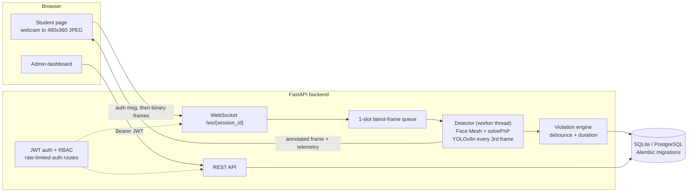

# ProctorAI — Real-Time Exam Proctoring Platform

[](https://github.com/Lakshit-Patel/AI-Cheating-Detection-System/actions/workflows/ci.yml)


A full-stack, real-time proctoring system. A student's browser streams webcam frames over an authenticated WebSocket; the backend runs **MediaPipe Face Mesh + OpenCV `solvePnP`** for head pose and **YOLOv8** for phone detection, turns noisy per-frame signals into **debounced violation events**, stores them in SQL, and shows them to an admin dashboard.

It is built as a backend-first project: the interesting parts are the real-time pipeline, the pose math, and the auth/security model, not the UI.

> **Design principle:** detections are *evidence for a human reviewer*, not verdicts. The system deliberately produces timestamped event logs and **no composite "cheating score"**. See [Limitations & ethics](#limitations--ethics).

---

## Highlights

- **Real-time pipeline** — binary JPEG frames over WebSocket, a 1-slot "latest frame wins" queue for backpressure, per-session inference throttling, and a worker thread so the event loop never blocks on CV.
- **Head-pose estimation from scratch** — 6 Face Mesh landmarks → `solvePnP` → pitch/yaw/roll computed from the rotation matrix's forward vector (no Euler-angle wraparound), with 3-frame smoothing.
- **Per-session calibration** — learns each student's neutral pose from 20 *stable* frames, so webcam height and desk angle don't cause false alarms. Restarts if the head moves, never calibrates on no-face/multi-face frames, and times out explicitly instead of hanging.
- **Hysteresis state machines** — left/right/up/down are tracked independently with enter/clear frame counts and a 0.7 exit ratio, so a head hovering near a threshold doesn't flicker.
- **Debounced violation engine** — an event opens after 2 consecutive frames, closes after 3 clear frames, and records its duration. Open events are finalized when the session stops or the socket drops.
- **Production-style auth** — bcrypt, short-lived JWT access tokens, **rotating refresh tokens with replay detection** (reuse revokes the whole token family), RBAC on REST *and* WebSocket, JWT never placed in a URL.
- **Alembic migrations, SQLite or PostgreSQL, Docker Compose, GitHub Actions CI, 60 tests.**

### Detected events

| Event | Source | Notes |
|---|---|---|
| `LOOKING LEFT` / `RIGHT` / `UP` / `DOWN` | Face Mesh + PnP, relative to calibrated baseline | Each direction has its own hysteresis state machine |
| `MOBILE PHONE DETECTED` | YOLOv8n, COCO `cell phone` | Confidence stored with the event |
| `NO FACE DETECTED` | Face Mesh | Student left frame or covered the camera |
| `MULTIPLE FACES` | Face Mesh (`max_num_faces=2`) | Blocks calibration and direction flags while active |

---

## Architecture



**Life of a frame**

1. The browser captures a 480×360 JPEG (quality 0.72) and sends it as a binary WebSocket message.
2. The receiver task drops any frame already waiting in the 1-slot queue — under load the system processes the *newest* frame instead of building lag.
3. The processor task enforces a minimum 0.15 s between frames (≈6.7 inference FPS per session), then runs `Detector.process_frame` in a worker thread.
4. The detector flips the frame, runs YOLO on every 3rd frame (cached boxes in between), runs Face Mesh, estimates pose, applies the calibration baseline, and updates the direction state machines.
5. The violation engine converts frame flags into start/end events; the backend writes them to the database.
6. The server replies with a JSON message: telemetry (angles, flags, calibration progress) plus the annotated frame as base64 JPEG.

A single bad frame (corrupt JPEG, transient detector error) produces a structured `error` message and the session continues; only 10 consecutive failures end it.

---

## Computer-vision pipeline

### Head pose
- Landmarks `33, 263, 1, 61, 291, 199` (eye corners, nose tip, mouth corners, chin) are matched to a generic 3D face model and solved with `cv2.solvePnP` (iterative, with an initial guess in front of the camera).
- The model's handedness matches the mirrored frame the detector feeds to Face Mesh. Getting this wrong makes `solvePnP` converge on a ~180° flipped pose; a regression test (`test_real_captured_landmarks_give_a_non_flipped_pose`) uses real captured landmarks to guard it.
- Angles come from the rotation matrix's forward/right vectors via `arctan2`/`arcsin`, so pitch and yaw are bounded and don't wrap through ±180°.

### Calibration
- Collects 20 stable samples and stores the **median** pitch/yaw as the student's baseline. All thresholds apply to the *relative* angle.
- A sample more than 10° from the running median means the head moved, so the window restarts.
- Non-finite, implausible, no-face, and multi-face frames never contribute. A 20 s timeout is reported to the UI and retried; it never silently marks calibration complete.
- Absolute pitch is deliberately not required to be near zero: a generic face model has a per-person constant offset that the baseline subtraction removes.

### Phone detection
- YOLOv8n at `imgsz=320`, class name `cell phone`, confidence ≥ 0.45, run every 3rd processed frame behind a thread lock, with the last boxes reused between runs.
- Weights are loaded lazily. If the file is missing, **phone detection disables itself without crashing the app**, and `/ready` reports the failure.

---

## Security model

| Concern | Mitigation |
|---|---|
| Password storage | bcrypt with per-password salt; inputs over 72 UTF-8 bytes are rejected instead of silently truncated |
| Brute force | Per-IP limits via SlowAPI: `/register` 5/min, `/login` 10/min, `/refresh` 20/min, `/logout` 20/min |
| Token theft | Access tokens last 30 min. Refresh tokens last 7 days, are stored as SHA-256 hashes, and rotate on every use. **Reusing a rotated token revokes the entire family.** |
| JWT leakage | WebSocket auth is a first JSON message (`{"type":"auth","token":…}`) with a 10 s timeout, so the token never appears in a URL or access log |
| Privilege escalation | Server-side RBAC (`student` / `admin`); the user ID is read from the verified `sub` claim, never from client input. Students can only read their own sessions, events and reports. |
| Resource exhaustion | 2 MB frame cap, binary-only frames, 1-slot queue, per-session throttle |
| Account lockout | Orphaned `ACTIVE` sessions are cancelled at startup and when a student starts a new one, so a crashed browser can't cause a permanent `409` |
| CORS | Explicit allow-list from `CORS_ORIGINS` |
| Privacy | **No video or images are stored.** Only event metadata (type, timestamp, duration, phone confidence) is persisted. |

---

## Quickstart

**Requirements:** Python 3.12, a webcam, Chrome/Edge/Firefox (webcam access needs `localhost` or HTTPS).

```bash
git clone https://github.com/Lakshit-Patel/AI-Cheating-Detection-System.git
cd AI-Cheating-Detection-System/Backend

python -m venv .venv
source .venv/bin/activate          # Windows PowerShell: .\.venv\Scripts\Activate.ps1
pip install -r requirements.txt

cp .env.example .env               # Windows: copy .env.example .env
# Generate a real signing key and put it in .env as SECRET_KEY:
python -c "import secrets; print(secrets.token_hex(32))"

alembic upgrade head
python seed.py --email admin@example.com --password "choose-a-password" --name "Administrator"
```

**Phone-detection weights** are not committed (`*.pt` is git-ignored). Download them once into `Backend/`:

```bash
python -c "from ultralytics import YOLO; YOLO('yolov8n.pt')"
```

Without this file everything else still works; phone detection is simply off.

**Run:**

```bash
# terminal 1, from Backend/
uvicorn app.main:app --host 127.0.0.1 --port 8000

# terminal 2, from Frontend/
python -m http.server 5500
```

Open <http://127.0.0.1:5500/login.html>.

- **Student flow:** register on the login page → *Start monitoring* → allow the camera → hold still until the status reads `SECURE` (calibration) → try looking away, covering the camera, or holding up a phone → *Stop monitoring*.
- **Admin flow:** log in with the seeded admin → see totals, browse sessions, open one to see each event with timestamp and duration.
- `GET /health` is a liveness check; `GET /ready` checks the database and reports phone-model status (`loaded` becomes `true` once a session has processed its first frames).

### Configuration

Set in `Backend/.env`. In production (`APP_ENV=production`) the app refuses to start without `SECRET_KEY`, and `/docs` is disabled.

| Variable | Default | Purpose |
|---|---|---|
| `APP_ENV` | `development` | `production` enforces `SECRET_KEY`; `test` disables rate limiting |
| `SECRET_KEY` | *(dev fallback)* | JWT signing key — **set your own** |
| `DATABASE_URL` | `sqlite:///./proctor.db` | SQLite locally, PostgreSQL in Docker |
| `CORS_ORIGINS` | `http://127.0.0.1:5500,http://localhost:5500` | Comma-separated allow-list |
| `ACCESS_TOKEN_EXPIRE_MINUTES` / `REFRESH_TOKEN_EXPIRE_DAYS` | `30` / `7` | Token lifetimes |
| `MAX_FRAME_BYTES` | `2097152` | Maximum accepted frame size |
| `DB_POOL_SIZE` / `DB_MAX_OVERFLOW` | `10` / `20` | PostgreSQL pool (ignored on SQLite) |
| `YAW_THRESHOLD_DEG` | `18` | Left/right threshold, relative to baseline |
| `LOOK_UP_THRESHOLD_DEG` / `LOOK_DOWN_THRESHOLD_DEG` | `25` / `25` | Up/down thresholds |
| `DIRECTION_ENTER_FRAMES` / `DIRECTION_CLEAR_FRAMES` | `3` / `3` | Frames to enter / leave a direction state |
| `CALIBRATION_SAMPLES` | `20` | Stable frames needed to calibrate |
| `YOLO_MODEL_PATH` | `yolov8n.pt` | Weights location |

> Thresholds are **starting values, not tuned across a population.** `.env.example` ships a slightly different set (20 / 18 / 25) as a worked example; adjust to your camera and review the live `Relative P/Y` overlay.

### Docker

```bash
cd Backend
# .env must define SECRET_KEY and POSTGRES_PASSWORD (compose refuses to start without them)
docker compose up --build
docker compose exec api python seed.py --email admin@example.com --password "choose-a-password"
```

This starts PostgreSQL 16 (with a healthcheck and a persistent volume) and the API, which runs `alembic upgrade head` before serving on port 8000. Serve the frontend the same way as above.

The image does **not** bundle the YOLO weights. To enable phone detection in Docker, download `yolov8n.pt` into `Backend/` and bind-mount it by adding `volumes: ["./yolov8n.pt:/app/yolov8n.pt:ro"]` to the `api` service.

---

## API reference

Interactive docs: `/openapi.json` (the Swagger UI at `/docs` is admin-only and disabled in production).

| Method & path | Access | Description |
|---|---|---|
| `POST /register` | public | Create a student account |
| `POST /login` | public | OAuth2 password flow (form-encoded `username`=email, `password`) → access + refresh tokens |
| `POST /refresh` | public | Exchange a refresh token for a new pair (old one is revoked) |
| `POST /logout` | public | Revoke a refresh token |
| `POST /api/v1/sessions` | student | Start an exam session (`409` if one is live) |
| `GET /api/v1/sessions/{id}` | owner / admin | Session status and violation count |
| `DELETE /api/v1/sessions/{id}` | owner / admin | End session; closes any open violations |
| `GET /api/v1/events/{id}` | owner / admin | Event list for a session |
| `GET /api/v1/reports/{id}` | owner / admin | Per-type violation counts and duration (no risk score by design) |
| `GET /sessions` | admin | All sessions |
| `GET /api/v1/sessions/{id}/violations` | admin | Violations for a session |
| `GET /statistics` | admin | Aggregate counts by violation type |
| `POST /api/v1/detect` | authenticated | Run the detector on one uploaded image |
| `WS /ws/{session_id}` | owner / admin | Live monitoring stream |
| `GET /health`, `GET /ready` | public | Liveness / readiness |

### WebSocket protocol

1. Client connects to `ws://host:8000/ws/{session_id}` and **immediately** sends `{"type":"auth","token":"<access token>"}`.
2. Server validates the token, user, ownership and that the session is `ACTIVE`; failures close with code `1008`.
3. Server sends `{"type":"ready","session_id":…}`.
4. Client sends binary JPEG frames. Server replies per processed frame with `{"type":"detection", …telemetry…, "frame":"<base64 jpeg>"}`.
5. Problems arrive as `{"type":"error","code":…}` (`binary_only`, `frame_too_large`, `invalid_frame`, `processing_failed`, `detector_init`) and the stream continues where possible.

A reference client lives in [`Backend/frontend-integration/ws_client.js`](Backend/frontend-integration/ws_client.js); see also [`Backend/FRONTEND_INTEGRATION.md`](Backend/FRONTEND_INTEGRATION.md).

### Data model

`users` (role `student|admin`) → `exam_sessions` (status `ACTIVE|COMPLETED|CANCELLED`) → `violations` (type, confidence, timestamp, duration), plus `refresh_tokens` (hashed, with `family_id` for replay detection). Foreign keys cascade, enums and the 0–1 confidence range are enforced with `CHECK` constraints, and common queries are indexed. Schema changes go through Alembic (`0001_initial`, `0002_refresh_tokens`).

---

## Testing

```bash
cd Backend
pytest -v          # 60 tests, no webcam or network required
```

| Area | What is covered |
|---|---|
| **Pose math** (18) | Sign and gain of yaw/pitch, no ±180° wraparound, yaw/pitch decoupling, degenerate input, a real captured landmark set producing a non-flipped pose, noise robustness |
| **Detector flow** (9+1) | Each direction firing alone and recovering, small movements ignored, no-face / multi-face / turned-head never calibrate, calibration timeout, per-session reset |
| **Auth & API** (14) | Hashing, 72-byte rejection, refresh rotation and **replay rejection**, logout revocation, inactive accounts, malformed/expired tokens, student-vs-admin and cross-student access |
| **Session lifecycle** (4) | Orphan cleanup, live-session `409`, detector failure surfaced without killing the socket |
| **Violation engine** (5) | Debounce, sustained events, simultaneous violations, finalization |
| **WebSocket** (6) | Auth handshake, unauthorized users, inactive sessions, invalid/oversized frames, violations persisted to the database |

CI (`.github/workflows/ci.yml`) installs dependencies, applies Alembic migrations and runs the suite on every push and pull request. Tests use a fake Face Mesh where determinism matters and real MediaPipe where it doesn't.

### Performance

`Backend/bench_pipeline.py` measures `Detector.process_frame` on live webcam frames (480×360), excluding capture, JPEG and WebSocket time:

```bash
python bench_pipeline.py 60
```

On a CPU-only laptop (no GPU) the detector averaged **21 ms per frame (p95 55 ms)** and kept up with a ~30 FPS webcam. In normal operation the server intentionally caps inference at ~6.7 FPS per session to bound CPU use. In a 9-minute test session of normal behaviour there were no false alarms, and all seven event types were triggered on a live webcam. This was a single-subject, single-machine test: it demonstrates the pipeline works, not that its accuracy generalizes.

---

## Limitations & ethics

> **Head pose and object detection are not proof of cheating.** Glancing at scratch paper, thinking with your eyes down, a disability, poor lighting, or an awkward camera position can all trigger events.

- **Human in the loop.** Output is an event log for a reviewer. No composite risk score is computed (`risk_score` is always `null` in reports).
- **Thresholds are untuned.** They were set on a small number of faces and cameras; a real deployment needs validation across people, devices and lighting.
- **Head pose is not gaze.** Eye movement without head movement is not detected.
- **Single-process design.** Live-session tracking and rate-limit counters are in memory, so run one worker. Scaling out would need a shared store (e.g. Redis) for both.
- **Frontend token storage.** The prototype keeps tokens in `localStorage`. A hardened deployment would use HttpOnly, Secure, SameSite cookies behind a backend-for-frontend, and terminate TLS in front of the app.
- **Cost model.** One Face Mesh instance per live session and CPU-bound inference mean concurrency is limited by cores, not by the async server.

## Roadmap

- Redis-backed rate limiting and live-session registry for multi-worker deployments
- Gaze estimation and audio cues as additional signals
- A labelled evaluation set to tune and report precision/recall per event type
- Exam, question and cohort models; evidence review UI with event timeline
- HttpOnly-cookie auth flow and a framework-based frontend

## Project structure

```text
.
├── Backend/
│   ├── app/
│   │   ├── main.py              # REST routes, WebSocket pipeline, session lifecycle
│   │   ├── detector.py          # Face Mesh + pose + YOLO per-frame orchestration
│   │   ├── pose.py              # solvePnP pose math, calibrator, direction state machines
│   │   ├── violation_engine.py  # debounced start/end events
│   │   ├── model_manager.py     # lazy, fault-tolerant YOLO loading
│   │   ├── auth.py / auth_routes.py / security_dependencies.py
│   │   ├── models.py / database.py / schemas.py / config.py / rate_limit.py
│   ├── alembic/                 # migrations
│   ├── tests/                   # 60 tests
│   ├── bench_pipeline.py        # detector benchmark
│   ├── seed.py                  # create the first admin
│   ├── Dockerfile / docker-compose.yml
├── Frontend/                    # login.html, index.html (student), admin.html
└── .github/workflows/ci.yml
```

## Author

**Lakshit Patel** — B.Tech CSE, VIT-AP University · [github.com/Lakshit-Patel](https://github.com/Lakshit-Patel) · lakshitpatel2005@gmail.com
